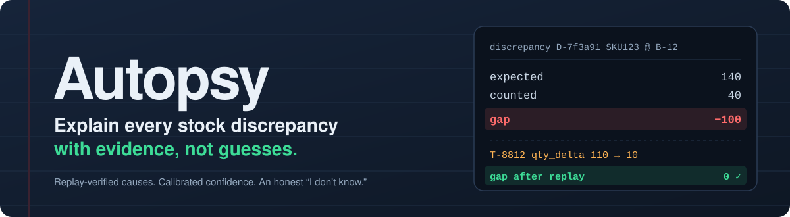
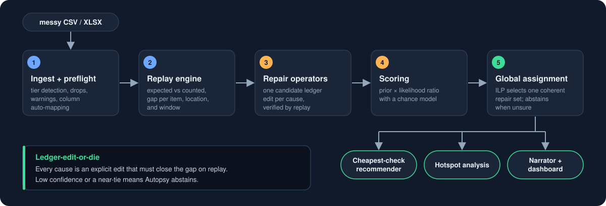
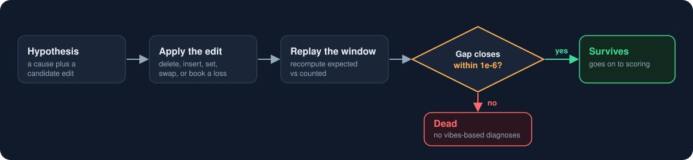
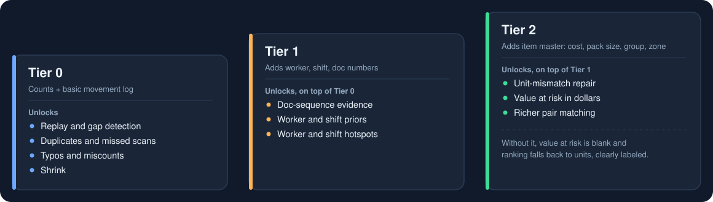

<div align="center">



<br>

**Autopsy takes a warehouse movement log and physical counts and answers the question every inventory controller asks:**
*why doesn't the system match the shelf?*

No new hardware. No WMS migration. Just the exports you already have.

<br>


[Why](#why-this-exists) •
[How it works](#how-it-works) •
[Example](#what-an-answer-looks-like) •
[Principles](#design-principles) •
[Getting started](#getting-started) •
[Evaluation](#evaluation-and-trust)

</div>

<br>

> [!NOTE]
> **Status:** this repository currently contains the [build plan](BUILD_PLAN.md). The layout and commands below describe the target implementation. Nothing is shipped yet.

## Why this exists

Inventory write-offs are usually blamed on "shrink" because finding the real cause means manually replaying weeks of transactions. Most of those discrepancies have mundane, fixable causes: a quantity typo, a pack-size mismatch, a scan that was missed or duplicated, a transaction booked to the wrong bin. Telling them apart today is slow, inconsistent, and rarely documented.

Autopsy automates the replay. For every discrepancy it produces:

- **Ranked, replay-verified hypotheses**: typo, missed scan, double scan, wrong location, shrink, and more
- **The cheapest physical check** that would confirm or refute the top cause
- **Error hotspots** across items, locations, workers, and shifts
- **An honest "I don't know"** when the evidence is thin

Every conclusion is backed by an explicit ledger edit that makes the gap disappear when replayed, and by a confidence score calibrated against reality.

## How it works

<p align="center">
  
</p>

### The core loop: ledger-edit-or-die

Every hypothesis is expressed as an **explicit edit** to the movement ledger or a count: a deleted duplicate, an inserted missed scan, a corrected quantity, a swapped item or location, a booked loss. The engine applies the edit, replays the affected window, and requires the gap to close within `1e-6`. If the edit does not close the gap, the hypothesis is dead.

<p align="center">
  
</p>

Candidates also carry a **search space** and a **competing matches** count, so a hypothesis that would only be true in one of 50 possible slots is scored as weak evidence, not as a confident answer.

### Abstention is a feature

When confidence is low or the top two causes are too close, Autopsy abstains and explains why. A wrong diagnosis sends someone chasing the wrong process. "Not enough evidence, here is the cheapest check that would settle it" does not.

Calibration happens on validation data only, with a target selective precision of **0.90** chosen to maximize answered coverage.

### Honest degradation by tier

Every feature declares the minimum data tier it needs, and the product degrades gracefully instead of crashing.

<p align="center">
  
</p>

| Tier | Data available | What unlocks |
|:--|:--|:--|
| **Tier 0** | Counts + basic movement log | Replay, duplicates, missed scans, typos, miscounts, shrink |
| **Tier 1** | + worker, shift, doc numbers | Doc-sequence evidence, worker/shift priors and hotspots |
| **Tier 2** | + item master (cost, pack size, group, zone) | Unit-mismatch repair, value at risk in dollars, richer pair matching |

Missing fields are reported as feature unavailability. They are never silently upgraded or filled with invented values. Without an item master, value at risk is blank and ranking falls back to units, clearly labeled.

## What an answer looks like

```json
{
  "id": "D-7f3a91",
  "item": "SKU123",
  "location": "B-12",
  "expected": 140,
  "counted": 40,
  "gap": -100,
  "abstain": false,
  "hypotheses": [
    {
      "cause": "qty_typo",
      "confidence": 0.71,
      "repair": {
        "ops": [
          {"op": "set_field", "txn_id": "T-8812", "field": "qty_delta", "from": 110, "to": 10}
        ]
      },
      "evidence": [
        "Receive T-8812 logged 110; setting it to 10 closes the -100 gap exactly",
        "This worker had 2 prior confirmed qty_typo labels"
      ]
    }
  ],
  "suggested_check": "Pull the receiving doc for T-8812; if it shows 10, not 110, the extra digit is confirmed"
}
```

Every number in that object is traceable to the input data or the replay, and every suggested check states the decision rule it tests.

## Design principles

| | Principle | What it means |
|:--|:--|:--|
| 📜 | **Contracts first** | Schemas, evidence JSON, and the eval protocol are locked before engine code, so ingest, dashboard, and narrator can be built in parallel. |
| ⚔️ | **Generator and solver are adversarial** | The solver author never sees injector internals, ground-truth generation, or blind seeds. The generator/eval owner reports aggregate metrics only. |
| 🤷 | **Abstention is a product feature** | "I don't know" is a valid, visible output. |
| 🔁 | **Every number is reproducible** | Accuracy, calibration, hotspot recovery, and timing come from the eval harness. No hand-typed metrics. |
| 🛡️ | **LLMs fail closed** | The narrator template and fuzzy column mapper work without an LLM. Any LLM output that fails entity validation falls back to the deterministic path. |
| 🏷️ | **Synthetic-to-real is disclosed** | Synthetic and partial public-data results are labeled as such in the UI and the deck. |

## Tech stack

| Area | Tools |
|:--|:--|
| Language | Python 3.11+ |
| Contracts | pydantic v2 |
| Data and math | pandas, numpy, scipy, scikit-learn |
| Optimization | PuLP / CBC |
| Ingest | openpyxl, rapidfuzz |
| Dashboard | Streamlit |
| Testing | pytest |
| LLM | none on the default or demo path |

## Repository layout

Planned:

```text
autopsy/
├── schemas/     pydantic contracts, feature tiers, validation CLI
├── ingest/      loaders, column auto-mapping, preflight reports
├── generator/   synthetic warehouse, error injectors, ground truth
├── engine/      replay, repair operators, scoring, assignment,
│                calibration, checks, hotspots, feedback
├── narrator/    deterministic autopsy text, optional LLM + validator
├── app/         Streamlit dashboard (Upload, Discrepancies, Autopsy,
│                Hotspots, Trust)
├── eval/        one-command eval harness, metrics, baselines, ablations
├── fixtures/    committed tier + messy + fake-evidence fixtures
├── tests/       pytest suite
└── docs/        scoring formulas, eval protocol, pilot materials
```

## Getting started

> [!IMPORTANT]
> These commands describe the target implementation and will work once the build lands.

```bash
python -m venv .venv && source .venv/bin/activate
pip install -r requirements.txt
```

**Validate the contracts**

```bash
pytest tests/test_contracts.py
python -m schemas.validate fixtures/evidence_fake.json
```

**Inspect a dataset before trusting it**

```bash
python -m ingest.preflight fixtures/tier1.csv
```

**Generate a synthetic warehouse and detect discrepancies**

```bash
python -m generator.make --seed 1001 --days 30 --errors 6 --out data/gen/demo
python -m engine.replay --dataset data/gen/demo --out data/gen/demo/gaps.json
```

**Reproduce every metric and chart**

```bash
python -m eval.run_all
```

**Launch the dashboard**

The dashboard is built fake-JSON-first and is never blocked on engine progress.

```bash
streamlit run app/Home.py
```

## Evaluation and trust

Nothing ships unless `python -m eval.run_all` regenerates the number that claims it. The harness reports, per cause and per difficulty:

| Metric family | Details |
|:--|:--|
| **Detection and attribution** | Detection F1 on window keys, top-1 / top-3 cause accuracy, cause-set recall on multi-cause windows |
| **Abstention** | Coverage vs. selective accuracy (the abstention curve) |
| **Calibration** | Expected calibration error (ECE) and Brier score, with reliability diagrams |
| **Hotspots** | Hotspot recovery and null false-discovery checks |
| **Value** | Value-weighted recall |
| **Baselines** | Rule-based, prior-only, raw-CSV-to-LLM |
| **Ablations** | Uniform chance model, greedy assignment, no calibration, no doc evidence |
| **Weakest cause** | Named explicitly, including when its support is too thin to claim anything |

Datasets are split into **dev**, **validation**, and **blind** sets. Blind seeds are owned by the generator/eval lead and never read by the solver author. Two consecutive runs from a clean data directory must produce identical metrics.

### Where it breaks

Autopsy is explicit about its limits. These are part of the product, not footnotes.

| Limit | Consequence |
|:--|:--|
| Offsetting errors | They can cancel to a zero gap and go unseen |
| Unlogged movements | They look like shrink |
| First count with no anchor | Cannot be attributed |
| Bad counts | Only confirmable by recounting |
| Day-only timestamps | Disable cutoff-timing analysis |
| LLM validator | Catches invented entities, not semantic errors that introduce no new entities |

## Documentation

| Document | Contents |
|:--|:--|
| [`BUILD_PLAN.md`](BUILD_PLAN.md) | The step-by-step build plan: contracts, gates, dependency graph, team split, and cut order |
| `docs/scoring.md` | Locked scoring formulas and heuristics |
| `eval/protocol.md` | Locked evaluation protocol, splits, difficulty definitions, metrics |
| `docs/pilot/` | Outreach, data request, and pilot log templates |

## License

Not yet specified.
