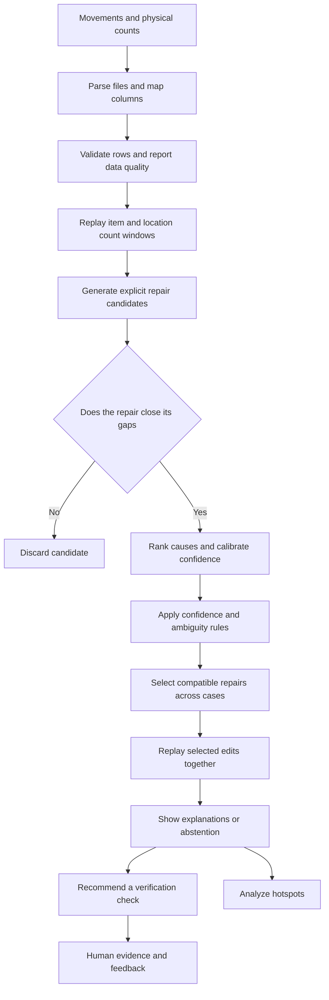
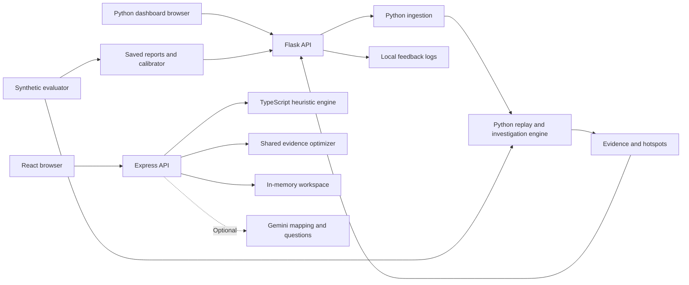

# Inventory Autopsy project and presentation guide

Inventory Autopsy investigates why inventory records disagree with physical stock. It takes warehouse exports, reconstructs balances, proposes explanations, and helps a person decide which evidence to check next. Its central promise is to make discrepancy investigations easier to explain, verify, and repeat.

The project currently contains a Python investigation engine and dashboard, plus a separate React and TypeScript product prototype. They demonstrate complementary parts of the idea, but they are not connected into one application. The Python engine provides the stronger replay and evaluation machinery. The React application demonstrates investigation management, shared evidence requests, and a proposed agent workflow.

This guide reflects the repository on November 26, 2026. Existing benchmark results are synthetic. Marketing, pricing, and development proposals below are plans to validate, not claims of customer adoption or proven savings.

## Reading paths

- **To understand the idea:** read The project in plain language, The problem and intended users, and A complete worked example.
- **To prepare for a mentor:** read The two applications, How the Python engine works, Evaluation and honest claims, Mentor presentation scripts, and Mentor questions and answers.
- **To run a demonstration:** read Running the project, Using the applications, and Demonstration scripts.
- **To explain the business:** read Product positioning and marketing, Business model and value measurement, and Proposed development roadmap.
- **To navigate the implementation:** use the technology tables, API overview, repository map, and source links throughout.

## The project in plain language

Imagine a warehouse system says there are 140 items in a bin. A worker counts only 40. The company knows there is a difference of 100, but that number does not explain what happened.

Someone might have entered 110 instead of 10 during receiving. A shipment might have been recorded twice. Goods might have moved to another bin. The physical count itself might be wrong. Recording the difference as a loss does not distinguish these possibilities.

Autopsy examines the movement history and asks: **What specific change to the records would explain this difference, and what evidence would confirm that change?**

The intended workflow is:

1. Import inventory movements and physical counts.
2. Calculate where recorded balances disagree with counts.
3. Generate possible explanations.
4. Test those explanations against the records.
5. Rank the surviving explanations and identify uncertainty.
6. Suggest a document check, scan audit, or recount.
7. Let a person confirm the cause and authorize any operational correction.
8. Look for recurring patterns that suggest a process improvement.

The name “Autopsy” refers to investigating an incident after it happened. “Inventory investigation assistant” is a useful description when introducing it to an audience unfamiliar with the name.

### One sentence for different audiences

**For anyone:** “Autopsy helps warehouses understand why the computer’s stock number does not match what is on the shelf.”

**For an operations manager:** “It turns movement logs and counts into an investigation queue with likely causes, supporting transactions, and the next check to perform.”

**For a technical mentor:** “The Python engine searches for explicit ledger repairs, verifies them by replay, ranks the candidates, resolves conflicts across cases, and abstains when the evidence is insufficient.”

**For a potential pilot customer:** “We can review an anonymized export and test whether the suggested causes and checks reduce your investigation work.”

## The problem and intended users

### Why inventory discrepancies are difficult

A discrepancy is the difference between what a business expects to have and what it physically counts. Finding the difference is relatively simple. Explaining it requires reconstructing the relevant history.

A person may need to compare receiving documents, dispatch records, transfers, quantities, dates, and count sheets. Several explanations can fit the same difference. Related cases may require the same document, yet separate investigations can ask different people for that document repeatedly.

The operational consequences can include wasted investigation time, avoidable recounts, unresolved adjustments, unreliable availability information, and repeated process mistakes. The repository does not measure the prevalence or financial size of these problems across the market.

### Intended users and buyers

| Person | Their problem | How Autopsy could help |
| --- | --- | --- |
| Inventory controller | Must reconcile counts with records | Provides a prioritized investigation and transaction-level explanations |
| Warehouse manager | Needs to assign work and understand recurring issues | Shows cases, evidence needs, and process patterns |
| Receiving or dispatch supervisor | Gets vague requests to investigate discrepancies | Receives a focused document or movement check |
| Finance or operations lead | Needs to understand adjustment exposure | Connects quantity differences to item costs when supplied |
| Internal reviewer | Needs to understand why a correction was proposed | Can inspect the proposed edit, supporting records, and uncertainty |

The daily user and the buyer may be different people. An inventory controller might use the tool while an operations manager approves a purchase.

### A practical first customer hypothesis

A sensible first segment is a wholesaler or distributor that has recurring cycle counts, exports from an existing stock system, and a person who currently investigates differences manually. This is a proposed starting segment because it matches the implemented data model and sample workflows.

A useful pilot customer needs enough history to reconstruct a balance. For the Python engine, that usually means at least two counts for the same item and location, plus the movements between them. A business with only a current stock total and no movement history will not provide enough evidence for this investigation method.

The product can sit alongside an existing ERP or WMS. ERP means enterprise resource planning software; WMS means warehouse management system. Export-based analysis avoids requiring a full system migration for a first pilot.

## A complete worked example

The following is a teaching example, not a customer incident or a claim about a specific demo screen.

A bin begins with a verified physical count of 50 units. The ledger then records:

| Event | Recorded movement | Running balance |
| --- | ---: | ---: |
| Opening physical count | 50 | 50 |
| Receipt T-8812 | +110 | 160 |
| Dispatch T-8813 | -20 | 140 |
| Closing physical count | 40 counted | Expected balance remains 140 |

The calculations are:

```text
expected = previous physical count + sum of recorded movements
expected = 50 + 110 - 20 = 140

gap = counted - expected
gap = 40 - 140 = -100
```

A negative gap means the count is below the recorded expectation. A positive gap means the count is above it.

One hypothesis is a quantity typo: the receipt was 10 units, but someone recorded 110. The proposed repair changes T-8812 from +110 to +10.

```text
repaired expected = 50 + 10 - 20 = 40
repaired gap = 40 - 40 = 0
```

This explanation passes the arithmetic test. It does not establish what physically happened. An unrecorded outbound movement of 100 units could also explain the original gap. A bad count could explain it too.

The next useful action is to inspect the receiving document for T-8812. If it shows 10 units, it corroborates the typo. If it shows 110, the investigator should reject or reconsider that hypothesis.

This distinction matters when explaining the project: **a replay-verified repair is mathematically consistent with the records; a confirmed real cause needs independent evidence.**

If each unit costs $8, the absolute discrepancy exposure is $800. That is an estimate of the value associated with the discrepancy. It is not automatically $800 stolen, $800 recoverable, or $800 saved by the software.

## The two applications

### Python investigation engine and dashboard

The application at the repository root runs with `python -m app.Home` and normally opens at `http://127.0.0.1:5000`.

Its main capabilities are:

- Importing and inspecting movement logs, counts, and item-master data.
- Replaying each item and location between physical counts.
- Generating nine families of possible repairs.
- Requiring repair candidates to close the claimed gaps.
- Scoring and calibrating explanations, with explicit abstention.
- Selecting compatible repairs across discrepancies.
- Recommending verification checks.
- Showing hotspots, feedback, exports, and evaluation reports.

The interface uses Flask, Jinja templates, browser JavaScript, and CSS. It is the best application to show when discussing the mathematical investigation method.

### React and TypeScript investigation workspace

The separate application in `inventory-autopsy/` runs with `npm run dev` and listens on port 3000.

Its main screens are Overview, Investigations, Agent Swarm, Automations, Integrations, and Reports. Investigations contains the case workflow, Evidence Lab, and Intake & Upload.

It includes real spreadsheet parsing, a simpler deterministic analysis pipeline, and an implemented evidence-selection algorithm. It also includes seeded data, modeled effort estimates, and simulated workflow behavior.

It is the best application to show when discussing the intended product experience. Its engine is implemented in TypeScript; it does not call the Python engine. A successful calculation in one application does not prove that the other has equivalent behavior.

### Implementation status at a glance

| Capability | Python application | React and TypeScript application |
| --- | --- | --- |
| CSV and Excel ingestion | Implemented, with multi-table preflight | Implemented; reads the first workbook sheet |
| Stock reconstruction | Item and location count windows | Groups by SKU and sums the supplied history |
| Explicit repairs and strict replay gate | Implemented | Uses cause heuristics and explanatory arithmetic |
| Statistical confidence calibration | Implemented with saved artifacts | Fixed heuristic scores in the intake engine |
| Abstention | Controls whether the engine answers | Evidence object and narrative represent uncertainty; workflow closure is less strict |
| Evidence check recommendation | Implemented per case | Implemented shared-document selection |
| Hotspot statistics | Implemented | Workflow and summary views do not replace the Python statistical analysis |
| Agent roles | Ordinary analysis modules | Role and activity visualization derived from application state |
| Email or Telegram delivery | Not implemented as a transport | Simulated status changes; no actual delivery adapter |
| External ERP correction | Not implemented | Proposed correction text and local status changes |
| Persistence | In-memory runs and local feedback logs | Shared in-memory workspace |
| Production authentication | Not implemented | Not implemented |

## Data requirements and terminology

### Essential concepts

| Term | Meaning |
| --- | --- |
| SKU | A stock-keeping unit, identifying an item or product variant |
| Location or bin | The place where the item is stored |
| Movement | A recorded receipt, dispatch, transfer, return, loss, or adjustment |
| Ledger | The ordered record of those movements |
| Signed quantity | Positive for stock entering a location, negative for stock leaving |
| Physical count | The quantity someone actually counted at a specified time |
| Anchor | An earlier physical count used as a starting balance |
| Count window | The time between an anchor and a later count |
| Hypothesis | A possible explanation for a discrepancy |
| Repair | A specific hypothetical change to a movement or count |
| Abstention | Declining to select a confident explanation |
| UOM | Unit of measure, such as individual units or cases |
| GRN | Goods received note, a receiving document |
| Hotspot | A group with an elevated observed rate of linked errors |

### Python canonical records

The schema is defined in [schemas/models.py](../schemas/models.py).

| Record | Fields |
| --- | --- |
| Movement | `txn_id`, `ts`, `item`, `location`, `qty_delta`, `event_type`; optional `doc_no`, `worker`, `shift` |
| Count | `count_id`, `count_ts`, `item`, `location`, `counted_qty` |
| Item master | `item`; optional `unit_cost`, `pack_size`, `similar_group`, `location_zone` |

Keep identifiers stable across files. `SKU-001` in counts and `SKU001` in movements will not automatically be the same item. Preserve leading zeros. Use timestamps with a consistent time convention and supply the real time of a count if cutoff analysis matters.

The parser can map aliases and generate missing IDs in some import paths, but canonical, stable IDs are preferable for tracing source records. A physical count is an observation, not another stock movement.

### Data tiers

| Tier | Available information | Main implications |
| --- | --- | --- |
| 0 | Basic movements and counts | Basic replay and repair searches; limited documentary context |
| 1 | Adds document, worker, and shift information | Enables stronger document signals and contextual slices |
| 2 | Adds sufficient item-master coverage | Enables item cost, pack size, and related-item information where populated |

The Python importer has concrete coverage rules: document, worker, and shift fields must each cover at least 80% of movements for Tier 1. Tier 2 additionally requires item-master coverage of at least 95% of active items. Tier 2 does not guarantee that every master field is populated; a pack-size check still needs an actual pack size.

Without usable unit cost, Python value at risk remains unavailable. It can prioritize by units instead. This is different from the TypeScript prototype, which currently supplies a default unit cost of 24 when cost data is missing or invalid.

### Example Python CSV inputs

`movements.csv`:

```csv
txn_id,ts,item,location,qty_delta,event_type,doc_no
T-8812,2026-11-02T09:00:00,SKU-001,A-01,110,receive,GRN-1001
T-8813,2026-11-03T10:00:00,SKU-001,A-01,-20,pick,DSP-2001
```

`counts.csv`:

```csv
count_id,count_ts,item,location,counted_qty
C-001,2026-11-01T08:00:00,SKU-001,A-01,50
C-002,2026-11-04T18:00:00,SKU-001,A-01,40
```

These files illustrate the arithmetic example. They do not meet all Tier 1 coverage requirements, and the engine may abstain depending on available corroboration and calibration. Do not promise a particular confidence from an example containing only two movements.

For a first real pilot, the existing [data request](pilot/data_request.md) asks for 8–12 weeks of movements, timestamped counts, and optional item-master information. Stable pseudonyms can replace sensitive identifiers without breaking joins.

## How the Python engine works



### File ingestion and preflight

`ingest/loaders.py` reads CSV, TSV, text exports, and supported Excel files. CSV ingestion handles common delimiters and a fallback text encoding. Excel ingestion reads sheets and helps identify movement, count, and master tables.

`ingest/mapping.py` proposes mappings from source headings to canonical fields. RapidFuzz supports fuzzy matching. `ingest/preflight.py` interprets dates, quantities, and event names, validates records, and reports dropped rows and missing information.

Preflight checks include duplicate identifiers, ambiguous dates, overlapping item-location keys, negative balances, duplicated count timestamps, and long gaps in movement history. The user reviews mappings and date interpretation before analysis.

This stage matters because a correct algorithm cannot repair an incorrectly interpreted dataset. Treating November 4 as April 11 can change which movements belong to a count window.

The optional OpenAI mapping path sends headers and sample cell types, not raw cell contents. It validates returned mappings and caches them locally. `AUTOPSY_LLM_MAPPING=0` disables these API requests. The standard fuzzy mapping path remains available.

### Replay and discrepancy detection

`engine/replay.py` groups records by item and location, sorts them, and reconstructs balances between consecutive counts.

The movement interval is `(previous_count_time, current_count_time]`: movements exactly at the previous count are excluded, and movements exactly at the current count are included. A precise interval convention prevents counting boundary transactions twice.

```text
expected balance = previous counted quantity + movements in the window
gap = current counted quantity - expected balance
```

The engine considers a difference meaningful when its absolute value exceeds `1e-6` units. This small tolerance avoids treating tiny floating-point residue as a stock difference.

The first count has no earlier physical anchor. The engine returns an unanchored result with no expected balance and asks for an earlier count. It does not infer that the first count itself proves a discrepancy.

### Nine repair families

| Cause | Possible explanation | Repair representation | Useful external check |
| --- | --- | --- | --- |
| `double_scan` | One movement was logged twice | Delete the suspected duplicate | Compare scan history with distinct physical movements |
| `missed_scan` | A movement happened but was not logged | Insert a hypothetical movement | Inspect missing documents or movement records |
| `qty_typo` | A quantity was entered incorrectly | Change a movement quantity | Inspect the source document |
| `unit_mismatch` | Cases and individual units were confused | Multiply or divide by item pack size | Verify packaging and receiving units |
| `item_swap` | A movement was assigned to another item | Change the item on a transaction | Check product labels and matching opposite gaps |
| `wrong_location` | A movement was assigned to another bin | Change the location on a transaction | Inspect both bins and transfer records |
| `miscount` | The physical count was wrong | Change the count quantity | Recount independently |
| `cutoff_timing` | A count boundary includes the wrong movements | Shift the count timestamp around nearby movements | Check actual movement and count times |
| `residual_shrink` | A shortage remains unexplained | Book a hypothetical residual loss | Investigate further before treating it as a confirmed cause |

`opening_balance` is also a schema cause label, but it represents missing anchoring information rather than a tenth error-search family.

The searches are deliberately bounded. For example, quantity typos include plausible digit mistakes, sign changes, and decimal-scale changes. Duplicate scans use matching quantities and nearby scans or repeated document references. Item and location swaps seek compatible opposing discrepancies. Cutoff analysis searches around the count boundary, within a 30-minute neighborhood in the current code.

The candidate cap is 50 per bounded search result path. It helps control runtime, but it also means the system does not examine every imaginable explanation.

### Explicit repair verification

A repair uses operations such as `delete`, `insert`, `set_field`, `set_count`, or `book_loss`. The engine applies these to a copy of the relevant records and replays the affected windows.

A candidate survives only if every gap it claims to explain closes within the tolerance. A proposed location swap that fixes one bin but leaves the other claimed gap open is rejected.

Original uploaded records are not overwritten by hypothetical repairs. Stale edits are rejected if their stated original value no longer matches the record. These details make explanations traceable and reduce accidental inconsistency during analysis.

### Scoring the surviving candidates

Many repairs can balance the arithmetic. Ranking asks which has the stronger evidence.

The scorer uses fixed starting frequencies, called priors, and an evidence multiplier:

```text
raw weight = prior for the cause × bounded evidence ratio

base evidence ratio = search opportunities / gap-closing matches
```

A match that occurs in one of many possible positions receives more weight than a repair that would work almost anywhere. Additional signals modify the ratio. Repeated document evidence can multiply it by 3; a missing number in a document sequence can multiply it by 2. The total ratio is capped at 50.

Recounts and residual loss bookings have ratio 1 because they can close a gap by construction. They need external confirmation before becoming a supported diagnosis.

The priors are currently quantity typo 0.20, missed scan 0.17, double scan 0.16, item swap 0.10, wrong location 0.10, unit mismatch 0.09, cutoff timing 0.09, miscount 0.06, and residual shrink 0.03. These are model assumptions, not measured rates for a customer’s warehouse.

Weights are normalized against the best candidate for each cause. Alternative edits within a leading cause remain available for conflict resolution. The score is a practical ranking model, not a proof of causality or a fully specified probabilistic model of warehouse operations.

### Feedback and contextual priors

Confirmed labels can adjust priors for global history, event type, location, worker, and shift. A slice with `n` labels receives a blending weight of `min(n / (n + 10), 0.75)`. The cap prevents a small local history from completely dominating the parent prior.

The latest label for a discrepancy supplies its active vote; “not sure” supplies no cause vote. Feedback changes later analyses rather than retroactively rewriting existing runs. Demo feedback is kept separate from uploaded-data feedback.

Worker-level patterns are associations in the available records. They do not establish that a particular employee caused an incident. Work assignment, data quality, and exposure can all affect the pattern.

### Confidence calibration and abstention

A raw ranking score of 0.8 is not automatically an 80% real-world correctness probability. Calibration learns how raw scores correspond to observed correctness on validation data.

`engine/calibrate.py` supports isotonic regression, logistic calibration, and a constant fallback for limited label distributions. The implementation generally uses isotonic regression with at least 500 samples and logistic calibration for smaller mixed-label samples. Cross-fitting helps estimate calibration without evaluating each example on the same fitted fold.

The threshold selection aims for 90% selective precision on validation data while retaining coverage. If the target cannot be met, the code can fall back to another threshold rule; the artifact records which rule was used. Without a saved calibrator, the engine uses a provisional threshold of 0.55.

An answer also needs sufficient separation between the top two raw cause scores, with a default margin of 0.1. Missing-scan explanations without enough corroboration, recounts, and residual-loss explanations remain tentative. An unanchored count always abstains.

Abstention means the tool still shows the investigation and a useful next check, but declines to declare a supported top cause.

### Compatible assignment across cases

Two individually plausible explanations can conflict. For example, two repairs might both try to delete the same transaction or change the same count.

`engine/assign.py` chooses a compatible set of candidates. It prevents resource reuse and allows at most one selected repair for a gap. A repair that legitimately explains two opposing gaps can cover both as one candidate.

The optimization objective compares each candidate’s probability with an abstention baseline of 0.05 using log ratios. An ordinary sum of log probabilities would make the empty selection attractive because those logs are nonpositive.

The implementation uses PuLP with CBC when available. Otherwise it uses SciPy’s mixed-integer optimizer with HiGHS. PuLP is optional and is not in the current pinned requirements. A greedy mode exists for evaluation comparisons.

After selecting candidates, the engine applies them together and replays again. This catches interactions that individual candidate tests might miss. Count changes that alter a later window are flagged as cascades.

### Choosing the next check

`engine/checks.py` reads a YAML catalog of checks, their effort estimates, and applicable causes. It filters unavailable documentary checks and scores applicable choices using uncertainty and estimated effort.

One score component is `4 × p × (1 - p) / effort`, where `p` is the top hypothesis confidence. This favors inexpensive checks around uncertain decisions. The effort values are configured estimates, not measured task durations for every warehouse.

For abstained anchored cases, the current analysis path generally recommends a recount and verification of the original count sheet. For an unanchored case, it asks for an earlier physical count.

### Hotspots

`engine/hotspots.py` compares observed repair-linked error rates across available slices. Exposure is based on transaction counts, which prevents a busy location from appearing worse simply because it has more activity.

It uses a Jeffreys beta prior for credible intervals, a hypergeometric enrichment test, and Benjamini–Hochberg correction across tested slices. In plain language: it expresses uncertainty and adjusts for the fact that searching many groups creates more opportunities for misleading findings.

Counterfactual improvement estimates assume a slice could reach its family’s median rate. They are conditional scenarios. They are not demonstrated savings or evidence that changing a particular worker’s behavior will achieve the result.

### Evidence and explanations

An evidence object connects the case, item, location, count window, expected and counted quantities, gap, hypotheses, proposed repairs, check, confidence status, and limitations.

The default narrator uses deterministic templates. The Python optional paraphrase adapter currently accepts output only if it matches the trusted template text after trimming whitespace. Otherwise it falls back. This is stricter than some older prose in the repository describing entity-only validation.

The Flask question endpoint also uses deterministic answering logic. Running the local Python dashboard does not require a language model to perform the investigation.

## How the React workspace works

### Server and browser responsibilities

The browser renders React components, sends actions to Express endpoints, and receives an updated workspace object. The server owns a single `workspaceState` variable in memory.

On startup, `createInitialWorkspaceState()` constructs a seeded workspace and `runAutopsyBench()` constructs benchmark display data. Uploaded analysis replaces the workspace. Restarting the process resets the state. Multiple clients share that same server workspace; there is no account-specific separation.

The frontend uses Vite middleware in development. In production mode, Express serves the built `dist/` files and continues to provide the API.

### Intake and analysis

An uploaded file is sent as base64 JSON. The server uses SheetJS to read the first worksheet. `inspect_dataset()` maps familiar headings and normalizes rows. If no familiar SKU heading is found and a Gemini key is configured, it can ask Gemini for a mapping using the headers and first sample row.

`reconstruct_inventory()` groups by SKU, sorts by the date string, sums movements, and compares the sum with the last supplied count for that SKU. It retains the final eight ledger entries for display.

This implementation is simpler than the Python count-window engine. In particular:

- It groups by SKU rather than item and location, so a SKU appearing across several warehouses can be combined.
- It does not implement the Python interval and anchor model for multiple counts.
- Dates are shortened to day strings, and cutoff heuristics include a fixed November 2026 date.
- Missing location, document, date, and cost information can receive defaults.
- A missing count does not produce an actual discrepancy, even though a warning mentions an audit snapshot.

Use this pipeline with the supplied sample format for a product demonstration. For real analysis, these assumptions need correction or replacement with the Python engine.

### Hypotheses and workflow

The TypeScript pipeline considers five categories: duplicate dispatch, unit-of-measure mismatch, unposted receipt, unrecorded transfer, and cutoff timing.

It gives these categories fixed heuristic scores according to quantity patterns and other checks. For example, a negative variance receives a strong unrecorded-transfer score. This is a starting hypothesis, not enough evidence to conclude that a transfer occurred.

The pipeline creates cases, groups them by category and warehouse, assigns seeded contacts, selects evidence documents, and prepares verification requests. Cases can move through states such as `ready_for_approval`, `waiting_for_evidence`, and `verified`.

### Shared evidence selection

This is a concrete implemented algorithm in the React application. Several cases can depend on the same receiving register or dispatch log. The optimizer selects a set of documents that covers as many target cases as possible, then minimizes the estimated collection effort.

For up to 14 candidate documents, it enumerates document subsets exactly. For larger sets, it uses a greedy rule: choose the document with the lowest effort per newly covered case.

For example, if one receiving register can help with five cases, requesting it once may be better than starting five separate requests. The result contains selected document IDs, covered case IDs, and estimated minutes.

Coverage here means “the configured document-to-case mapping says this document is relevant.” It does not mean that receiving the document automatically proves every case. A single document may cover all cases but leave competing explanations unresolved.

The individual-case baseline is modeled as 18 minutes per case. Estimated effort savings therefore describe assumptions in the model, not a completed human timing study.

### What the agent swarm represents

The interface names roles such as Sentinel, Data Engineer, Detective, Forensic Analyst, Financial Analyst, Evidence Hunter, Communicator, Resolution, Auditor, Prevention, Reporting, and Learning.

These roles communicate the proposed division of work: intake, investigation, evidence collection, review, resolution, and prevention. In the current implementation, the roles are state-derived profiles and activity events. They are not twelve independently running model agents.

The run-cycle endpoint logs a workflow event and refreshes derived state. It does not start a durable background investigation. Automation toggles and custom rules are stored in the workspace; they do not establish a functioning scheduler or queue.

A good description for a mentor is: “The interface models how specialized investigation roles could cooperate. The current execution is deterministic application logic, with optional Gemini assistance for mapping and questions.”

### Approval and verification limitations

Approving a request changes its state to `sent_awaiting_reply` and updates the activity log. The current endpoint does not send email or Telegram messages. Connector cards showing “connected” are seeded UI state, not proof of live service credentials or message delivery.

The reply simulation is similarly simplified. A response containing “unable” challenges the case. Other answers can mark the related cases verified and raise the leading score to 99. The endpoint does not comprehensively compare the submitted answer with the hypothesis, validate supporting documents, or enforce the stored token expiration.

The direct sign-off endpoint marks a case verified and prepares correction text. It does not replay a subsequent ERP export or independently establish that an external adjustment occurred.

Autonomy settings describe intended limits, but several limits are not enforced as durable counters and policies. A pause flag blocks the run-cycle endpoint; it should not be described as a complete production authorization boundary.

These are important next implementation tasks before connecting real messaging or using the workspace to authorize actual stock changes.

## Technologies used and how to explain the choices

The explanations below are engineering justifications for the current design. They do not claim to reconstruct the author’s private reasoning when each tool was first selected.

### Python stack

| Technology | Where it helps | Why it is appropriate | Tradeoff |
| --- | --- | --- | --- |
| Python | Analysis, ingestion, evaluation | Readable data-processing code and a strong scientific ecosystem | Large workloads may need profiling, indexing, and background execution |
| Pydantic v2 | Record and evidence contracts | Rejects malformed values and makes output structure explicit | Schemas need versioning as the product evolves |
| pandas | Reading and manipulating tabular exports | Fits CSV and spreadsheet workflows | In-memory tables can become expensive at large scale |
| openpyxl | Reading Excel workbooks | Supports a common warehouse export format | Spreadsheet formatting does not guarantee clean underlying data |
| RapidFuzz | Column-name matching | Provides inexpensive deterministic mapping suggestions | Ambiguous mappings still need review |
| NumPy | Numeric operations | Supports calibration and statistical calculations | Requires attention to numerical conventions |
| SciPy | Optimization and statistics | Supplies HiGHS-backed mixed-integer optimization and statistical functions | Optimizer performance depends on candidate and conflict counts |
| scikit-learn | Confidence calibration | Provides established regression implementations | Calibration quality depends on representative labels |
| PuLP and CBC | Optional repair assignment solver | Expresses binary selection constraints directly | Optional installation; current requirements rely on the fallback |
| Flask and Jinja | Local dashboard and API | Keeps analysis and a usable interface in one Python process | Current app lacks production identity and durable run storage |
| PyYAML | Check catalog | Separates check wording and effort configuration from code | Catalog values require validation against real work |
| Babel and locale catalogs | Localized presentation | Separates displayed language from canonical evidence | Translations need domain and native-language review |
| pytest | Behavioral verification | Tests repairs, replay boundaries, ingestion, narration, and app behavior | Passing tests does not establish real-world usefulness |

`python-dateutil` supports date parsing. Pillow supports generated image assets and related presentation tooling. Pinned versions live in [requirements.txt](../requirements.txt); use that file as the installation reference.

### React and TypeScript stack

| Technology | Where it helps | Why it is appropriate | Tradeoff |
| --- | --- | --- | --- |
| React | Stateful investigation screens | Reusable components for cases, requests, forms, and dashboards | Product state can diverge from server truth without careful contracts |
| TypeScript | Shared types and server logic | Makes relationships among cases, requests, evidence, and UI clearer | Static types do not validate untrusted runtime requests |
| Express | JSON endpoints | Small server that can host both the API and built frontend | Authentication, validation, and persistence must be added explicitly |
| Vite | Development and frontend build | Supports a fast development loop and static asset bundling | The frontend build alone does not include a working API server |
| Tailwind CSS | Styling | Makes consistent spacing, colors, and responsive layouts convenient | Utility-heavy components require discipline to remain readable |
| Motion | Animation | Communicates transitions and interface state | Animations are presentation, not evidence of background work |
| Lucide React | Icons | Gives the interface consistent visual labels | Icons still need clear text and accessible controls |
| SheetJS `xlsx` | Spreadsheet parsing | Reads the file formats used by the prototype | Current route only analyzes the first sheet |
| `@google/genai` | Optional mapping and workspace Q&A | Adds language assistance around structured application data | Requires network access, credentials, and output checks |
| `dotenv` and `tsx` | Environment loading and server execution | Keeps local development straightforward | Environment-file behavior must match startup instructions |

Dependencies and scripts are declared in [inventory-autopsy/package.json](../inventory-autopsy/package.json). A Bun lockfile is present. Package names and versions describe this checkout, not a recommendation to upgrade to the newest release.

### Why deterministic arithmetic matters

The project’s central engineering choice is to keep stock arithmetic explicit. A sentence that sounds convincing is insufficient when it proposes an inventory correction. Replay gives a checkable relationship between the explanation and the numbers.

Language models can help interpret unfamiliar column headings or explain structured results. They do not need to decide whether `50 + 10 - 20` equals 40. This separation also makes the Python demonstration usable without an API key.

## AI behavior and data boundaries

| Feature | Current behavior |
| --- | --- |
| Python investigation engine | Deterministic replay, search, scoring, and optimization; no LLM needed |
| Python mapping helper | Optional OpenAI request with headers and cell-type samples |
| Python narrative | Deterministic template; optional adapter falls back unless output matches trusted text |
| Python raw-CSV baseline | Separate opt-in evaluation command sends verified synthetic CSV data |
| React column mapping | Optional Gemini request with column headings and a sample row |
| React Ask Autopsy | Sends a compact workspace summary and the question to Gemini |
| React baseline | Separate Gemini benchmark path over synthetic CSV slices |
| React agent swarm screen | Role and event visualization; not independent LLM execution |

The Gemini adapter currently specifies the model string `gemini-4-hydrogen`. Treat this as a configuration in the source, not a guarantee that the model is available to a particular API account. The default product demonstration can run without Gemini; workspace questions need a working key and accessible configured model.

The TypeScript narrator includes an entity validator for identifiers and numbers. The Gemini question endpoint does not route answers through that validator; it extracts known case IDs appearing in the answer. Prompt instructions alone do not guarantee that every statement is correct.

The Python app can operate locally with LLM mapping disabled. Non-English currency display may still try to fetch an exchange rate in the browser. The React app sends data externally only through the optional model features described above; its interface can otherwise demonstrate local workflows without a model call.

## Evaluation and honest claims

### What the Python benchmark measures

The generator creates synthetic warehouses and injects known errors. Evaluation compares solver output with those injected labels. Development, validation, and blind splits have different roles: develop the solver, fit calibration and thresholds, and report held-out behavior.

The protocol specifies easy, medium, and hard scenarios. Hard cases include overlapping errors, offsets, cutoffs, count corrections, incomplete logs, and noisy metadata. Synthetic generation gives known labels, but it cannot establish performance on a customer’s actual incident distribution.

The current checked-in full report is [synthetic-967dabe128a6/RESULTS.md](../eval/results/synthetic-967dabe128a6/RESULTS.md). These are saved results, not a newly rerun full benchmark for this guide.

| Metric | Saved result | Meaning |
| --- | ---: | --- |
| Anchored detection F1 | 100.0% | Identifies the benchmark’s nonzero anchored discrepancy windows |
| Top-1 cause accuracy | 69.0% | First-ranked cause is correct on evaluated single-cause windows |
| Top-3 cause accuracy | 95.3% | True cause appears among the top three on those windows |
| Aggregate coverage | 5.9% | Fraction of eligible discrepancies receiving an answer after abstention |
| Selective accuracy | 96.4% | Correctness among answered single-cause windows |
| Multi-cause recall | 24.6% | Recovery of injected causes in overlapping-error cases |
| Value-weighted recall | 3.1% | Share of evaluated discrepancy value correctly attributed and answered |
| Blind ECE | 2.7% | Aggregate discrepancy between confidence and observed correctness |
| Cross-fit validation ECE | 4.3% | Calibration error estimated through validation folds |
| Brier score | 0.2053 | Squared error of confidence predictions; lower is better |
| Weakest supported cause | Miscount | Weakest cause among those meeting the support requirement |

Selective accuracy and coverage must be presented together. “96.4% accurate” by itself would omit that the current production decision policy answers a small fraction of cases. Coverage and selective accuracy also use somewhat different eligible populations, as defined in [eval/protocol.md](../eval/protocol.md).

Top-3 accuracy is useful evidence for an investigation assistant, because a human can inspect alternatives. It is not equivalent to automatically resolving 95.3% of incidents.

### Gates and ablations

The saved report passes the easy improvement, calibration, and controlled hotspot gates. It misses the hard-case improvement gate at half coverage: the reported improvement is -1.5 percentage points against a target of +10 points.

An ablation removes one part of the algorithm to see what changes. In the saved run:

- Removing calibration increases coverage to 69.6% while selective accuracy falls to 70.5%.
- Removing abstention produces 100% coverage with 69.0% selective accuracy.
- Greedy assignment has the same aggregate top-1 result as the standard assignment on this benchmark.
- Removing document-number evidence increases top-1 accuracy to 72.0%, but changes coverage and selective accuracy.

These results suggest a research direction: improve evidence and decision coverage while preserving reliable answers. They do not demonstrate that every additional algorithmic component already improves every metric.

### Why the React benchmark must be described separately

`inventory-autopsy/RESULTS.md` contains a different synthetic report, including a 60-scenario threshold table. The TypeScript Trust parser reads that Markdown and supplies fallback constants if needed.

The displayed comparison among manual analysis, a generic chatbot, a rule engine, and Autopsy includes hard-coded accuracy, time, cost, and closure figures. The TypeScript benchmark also uses confidence above a threshold as an “accurate” proxy and applies a minimum displayed Autopsy accuracy. That is not a ground-truth measurement of cause correctness.

Therefore, do not use the React comparison chart as proof that Autopsy outperforms human analysts, a language model, or another product. Describe it as illustrative product benchmark presentation. Use the Python harness and saved report for the implemented evaluation methodology, and run a real study before making customer performance claims.

The default workspace also includes historical resolution counts and modeled effort savings. It is a seeded product scenario, not a record of actual customers using the application.

### Measuring real usefulness

The repository’s [timing study plan](timing_summary.md) records no completed human timing measurements. It proposes the same three cases for at least five testers, manual-first and tool-first ordering, a 15-minute case limit, and measurement of correctness alongside time.

A useful pilot should measure:

1. Time to a correct cause or a useful next check.
2. Percentage of cases a reviewer finds actionable.
3. Incorrect conclusions and unnecessary recounts.
4. Number of evidence requests and repeated requests.
5. Import failures and time spent preparing data.
6. Cases that remain unresolved and why.
7. Whether the same type of discrepancy recurs after a process change.

## Running the project

### Python application

Run the following from the repository root in a Unix-like shell:

```bash
cd /home/ceon/proj/autopsy
python -m venv .venv
source .venv/bin/activate
python -m pip install -r requirements.txt
AUTOPSY_LLM_MAPPING=0 AUTOPSY_FEEDBACK=0 python -m app.Home
```

Open `http://127.0.0.1:5000`. The environment flags keep the rehearsal deterministic and prevent feedback from affecting later uploaded analyses. Omit `AUTOPSY_FEEDBACK=0` when intentionally testing feedback.

The repository describes Python 3.11 or newer. Package compatibility also depends on the pinned requirements. Stop the server with Ctrl+C. On a different computer, replace the absolute project path with its checkout location.

To inspect an input before launching the dashboard:

```bash
python -m ingest.preflight fixtures/tier2.xlsx
python -m ingest.preflight fixtures/messy_3.xlsx
```

To generate and replay a fresh synthetic dataset:

```bash
python -m generator.make --seed 1001 --days 30 --errors 6 --out data/gen/presentation
python -m engine.replay --dataset data/gen/presentation --out data/gen/presentation/gaps.json
```

The generator writes dataset files and ground truth. The replay command detects gaps; it is not the full attribution pipeline. Use the dashboard or the analysis API for explanations.

To run the Python tests:

```bash
python -m pytest
```

To regenerate the full synthetic evaluation:

```bash
python -m eval.run_all
```

This writes evaluation artifacts and updates the `eval/results/latest` pointer. For a smaller preview:

```bash
python -m eval.run_all --limit 2 --skip-feedback
```

Preview results have separate preview output names and should not be presented as the full benchmark. Add `--strict` when you want missed benchmark gates to produce a nonzero exit status.

### React and TypeScript application

From a second terminal:

```bash
cd /home/ceon/proj/autopsy/inventory-autopsy
npm install
npm run dev
```

Open `http://localhost:3000`. This starts Express and its Vite development middleware. It does not require the Python server to be running.

The default workspace, upload path with recognized columns, evidence optimization, and simulated request workflow do not need a Gemini key. Leave the key unset for an offline product walkthrough.

For optional Gemini features, provide `GEMINI_API_KEY` in the server environment or an uncommitted `.env` file in `inventory-autopsy/`. The server imports `dotenv/config`, which reads `.env` by default. The scaffold README mentions `.env.local`, but the Express startup does not explicitly load that file; do not rely on it for server credentials.

Run the existing checks with:

```bash
npm run lint
npm test
npm run build
```

Here `lint` invokes TypeScript type checking, and the current `test` script runs the i18n test file. These commands are not a comprehensive test suite for forensic correctness.

To serve the built frontend with its API:

```bash
npm run build
NODE_ENV=production npm start
```

Run this from `inventory-autopsy/` because the server resolves `dist/` and `RESULTS.md` relative to the working directory. `npm run preview` previews Vite assets; it does not start the Express API needed for the complete application.

The current Express server binds to `0.0.0.0`, so it may be reachable from other machines on the network. Use this unauthenticated prototype in an appropriate local demonstration environment, not as a public service containing customer data.

### Practical troubleshooting

| Symptom | Likely explanation and action |
| --- | --- |
| Python module cannot be imported | Activate the intended virtual environment and install its requirements |
| Port 5000 or 3000 is occupied | Stop the earlier app instance or configure a different launch port where supported |
| Upload produces no usable counts | Check count mapping, count timestamps, and the selected workbook or count file |
| Every case is uncertain | Review anchors and data quality; strict calibration can legitimately produce low coverage |
| Unit-mismatch analysis is unavailable | Supply pack sizes and sufficient metadata for the required tier |
| React upload sees only part of a workbook | Its route reads the first sheet; use the supplied flat format or the Python importer |
| React Ask Autopsy fails | Check server-side key loading and configured model access; the deterministic demo still works |
| React app loses cases after restarting | Workspace persistence is currently in memory |
| Python uploaded run disappears | The server restarted or its 16-run cache evicted an older run |
| A connector says connected but no message arrives | The connector card is simulated; no transport is configured |
| A built React page cannot load workspace data | Start Express with `npm start`, not only a static preview server |

## Using the applications

### Python user journey

1. Open the dashboard and inspect the synthetic demo.
2. Open Upload data and choose `fixtures/tier2.xlsx` for a complete small example, or `fixtures/messy_3.xlsx` to demonstrate imperfect exports.
3. Inspect source columns, mapping suggestions, and date order.
4. Choose **Confirm & analyze**.
5. Read the preflight report before interpreting the findings.
6. Open Discrepancies and select an anchored case.
7. Compare expected quantity, counted quantity, gap, and available cost information.
8. Read the proposed causes and expand a repair or replay view.
9. Follow the suggested documentary or physical check.
10. Review Hotspots and Trust & evaluation.
11. Export the discrepancy CSV for discussion or follow-up.

When feedback is enabled, confirm or correct a non-abstained diagnosis only after checking real evidence. Feedback changes future priors; clicking “correct” is not a substitute for verification.

### React user journey

1. Start at Overview to explain the investigation queue and workflow.
2. Open Investigations and select Intake & Upload.
3. Use **Download sample CSV**, then upload it to show actual parsing and case creation. Alternatively use **Run live 25,000-row audit** for the generated sample.
4. Review the mapping and warning summary.
5. Open a case and inspect its ledger trace, candidate explanations, and requested evidence.
6. Open Evidence Lab and compare the document choices with the optimized selection.
7. Approve a request and explain that its delivery is simulated.
8. Use **Simulate employee reply** to illustrate the follow-up workflow.
9. Review the updated case state and draft corrective-action text.
10. Open Reports and explain which figures are calculations, estimates, and illustrative benchmark values.

**Reset workspace** restores the seeded scenario. It replaces the current in-memory analysis.

### Languages and currencies

Both applications include English, Uzbek Latin, Uzbek Cyrillic, Russian, Turkish, Kazakh, Simplified Chinese, Spanish, and Arabic. The locale codes are `en`, `uz`, `uz-Cyrl`, `ru`, `tr`, `kk`, `zh`, `es`, and `ar`. Arabic has right-to-left presentation support.

Localization changes display strings and formatting while preserving canonical identifiers and cause codes. Translations should receive native and warehouse-domain review before customer release.

The Python dashboard treats source costs as USD and can display converted amounts using a browser-fetched reference rate associated with the language. It shows the rate date and falls back to USD when unavailable. CSV exports preserve source amounts. The React formatter uses USD with locale-appropriate formatting; it does not perform the Python currency conversion behavior.

Neither implementation should be described as a full multi-currency inventory valuation system.

## Demonstration scripts

### Prepare before the meeting

Start the servers and open the exact pages you will use. Use synthetic examples. Check that your chosen case and fixtures work before the meeting. Keep Gemini-dependent Q&A out of the critical demo path unless you have already checked it.

Know which application you are showing. Port 5000 is the Python analytical demonstration. Port 3000 is the React product workflow. They do not share uploads, cases, or confidence calculations.

Keep the arithmetic example, one repair, one uncertain case, and the saved evaluation report available. A useful demonstration can succeed with those four pieces even if a cosmetic screen or optional service is unavailable.

### A three-minute product introduction

| Time | Action | Suggested narration |
| --- | --- | --- |
| 0:00–0:30 | State the problem | “A stock difference tells us something is wrong, but it does not tell us why. Investigators have to reconstruct movements and collect documents.” |
| 0:30–1:10 | Show one case | “Here are the expected and counted quantities. These transactions explain how the recorded balance was reached.” |
| 1:10–1:50 | Show a hypothesis and next check | “The tool proposes an explanation and identifies the evidence needed to confirm it. The cause remains provisional until that check.” |
| 1:50–2:25 | Show evidence selection or replay | “The engine tests explicit repairs, and the product prototype groups evidence requests so related cases can share a document.” |
| 2:25–3:00 | State status and ask | “The analysis is tested on synthetic data. I am looking for a pilot export and feedback on whether these checks fit real warehouse work.” |

Choose replay for a technical audience and Evidence Lab for an operations audience. Do not try to show every tab in three minutes.

### A seven-minute technical demonstration using Python

**First minute — establish the question.** Show the synthetic dataset and explain expected versus counted quantity. State that the data is generated.

**Second minute — inspect the input.** Upload `fixtures/tier2.xlsx`, show mapping and preflight, and explain why invalid rows or missing metadata change what the engine can do. Return to the synthetic demo for the larger investigation example.

**Third and fourth minutes — show a concrete repair.** In the checked demo, an answered case is `D-81bc81de2082`, for `SKU-501` at `A-02`, ending April 2, 2025 at 18:05. It has expected quantity 177, counted quantity 173, and gap -4. The proposed duplicate-scan repair deletes transaction `X-0019`; the evidence cites repeated document 1300 and transaction `T-00301`.

Say: “The recorded balance includes four extra units. Removing this suspected duplicate changes the expected balance from 177 to 173. The engine verifies that result. We still need to audit the scans and establish that the two entries refer to one physical movement.”

The current artifact gives this case 0.99 calibrated confidence and $304.12 exposure. Those values belong to this synthetic example and calibration artifact. If you regenerate the demo or change the code, rehearse the case again rather than assuming the same ID and score.

**Fifth minute — show uncertainty.** Open an unanchored or abstained result. Explain that a first count needs an earlier anchor and that multiple plausible causes may remain unresolved. This is a good place to show the suggested next check.

**Sixth minute — show the evaluation.** Present 69.0% top-1, 95.3% top-3, and 96.4% selective accuracy at 5.9% aggregate coverage. State the missed hard-case gate.

**Seventh minute — state the next experiment.** Propose a small labeled real-data pilot and a timed manual-versus-assisted comparison. Ask for feedback on the data requirements and whether the suggested checks are operationally useful.

### A seven-minute product demonstration using React

**First minute:** Show Overview. Describe the seeded workspace as the intended operational experience, not a live warehouse.

**Second minute:** Open Intake & Upload. Download the sample CSV and upload it, or run the generated audit. The function behind the “25,000-row” button currently produces 25,010 rows, so use the actual displayed count when speaking precisely. It creates eight discrepant sample SKUs; the reset workspace is a different seeded scenario.

**Third minute:** Show a sample case. The small downloaded CSV includes `SKU-2048` with opening 120, dispatch -24, and receipt +48: recorded expectation 144 versus count 192, a +48 gap. At the sample unit cost of $24, absolute exposure is $1,152. A 2× receipt-unit interpretation is one hypothesis to verify against the receiving record.

**Fourth minute:** Open Evidence Lab. Show that one receiving document can serve several related cases. Explain that the algorithm minimizes configured effort after maximizing coverage.

**Fifth minute:** Approve a request and use the simulated reply. State explicitly: “This demonstrates the state transitions. No real email or Telegram message is sent.” Do not present the resulting verified badge as an independent re-audit.

**Sixth minute:** Show Agent Swarm and autonomy controls briefly. Explain the roles and intended governance. State that durable scheduling, real integrations, and complete policy enforcement are future work.

**Seventh minute:** Show Reports, distinguish modeled figures from measured results, and explain the plan to connect this interface to the Python engine.

### Demo fallback and rehearsal

If a live import fails, use the existing synthetic demo and explain the data-quality issue rather than changing the story. If Gemini is unavailable, continue with deterministic analysis. If asked about real customer performance, show the synthetic disclosure and pilot plan.

The repository includes `scripts/rehearse_demo.py`, which uses Playwright to run five Python-dashboard rehearsals and record the fifth. Playwright and Chromium must be installed separately; they are not in the main requirements. With those available and the Python server running:

```bash
python -m scripts.rehearse_demo --out data/demo
```

The selected output directory receives the recorded demonstration. A saved recording is useful as a fallback, but rehearse your explanation as well as the clicks.

## Mentor presentation scripts

### Thirty-second introduction

“I’m building Inventory Autopsy to help warehouses investigate stock discrepancies. It compares movement records with physical counts, proposes possible causes, and recommends what to check next. The Python engine tests explanations by applying explicit hypothetical repairs and replaying the ledger. I also have a React prototype for managing cases and grouping evidence requests. The current evaluation is synthetic; my next step is a real-data pilot and a timed usability study.”

### Two-minute explanation

“The problem is that a warehouse often knows its stock is wrong without knowing why. A missing scan, a duplicate posting, a quantity typo, a unit conversion, and a bad count can look similar in an adjustment report.

“Autopsy starts with exports the company already has: movements, physical counts, and optionally item-master information. It reconstructs balances between counts. For every discrepancy, the Python engine generates concrete changes that could explain it. A candidate only survives if replaying the changed records closes the gaps it claims to explain.

“After that, the system ranks explanations, avoids conflicting repairs, and can abstain. It recommends a document check or recount so that a person can verify the cause. The React prototype explores the surrounding workflow, especially using one evidence request for several related cases.

“I used Python for the analysis and evaluation stack, and React with TypeScript for the richer product interface. They are separate implementations today, so connecting the UI to the Python engine is a priority.

“The current Python synthetic benchmark has 69% first-choice cause accuracy and 95.3% top-three accuracy. Its strict answering policy reaches 96.4% selective accuracy with only 5.9% coverage. That tells me the main challenge is improving useful coverage without producing unreliable conclusions.

“I’d like your advice on the first customer segment, access to representative data, and the smallest experiment that could show whether this saves investigation time.”

### Suggested presentation slides

| Slide | Content | Evidence to show |
| --- | --- | --- |
| 1 | The warehouse discrepancy problem | A simple expected-versus-counted example |
| 2 | Intended user and workflow | Inventory controller, supervisor, manager |
| 3 | The solution | Import → investigate → check evidence → human decision |
| 4 | Technical mechanism | One explicit repair and before/after replay |
| 5 | Product experience | Case view and shared evidence selection |
| 6 | Evaluation and limitations | Python metrics, coverage, and missed gate |
| 7 | Architecture and stack | Two applications and the planned connection |
| 8 | Next experiment and request | Pilot dataset, labels, timing study, mentor introduction |

Put the problem before the technology list. The audience should understand why the system exists before hearing library names.

## Mentor questions and answers

**What is the main innovation?**

The strongest implemented idea is representing an explanation as an explicit repair and verifying it through replay. The evidence-selection prototype adds another useful idea: reduce duplicated investigation effort by sharing document requests across cases.

**Is this a chatbot over a spreadsheet?**

The Python core is a structured investigation engine. It computes balances, searches bounded repairs, optimizes compatible assignments, and reports uncertainty. Language-model assistance is optional around mapping and presentation.

**Is this machine learning?**

Parts are statistical learning, especially calibration and feedback-adjusted priors. Much of the system is deterministic parsing, arithmetic, rule-based candidate generation, and optimization. It does not require training a large neural network to perform the main calculation.

**Why use two programming languages?**

Python fits analysis and evaluation. TypeScript fits the interactive browser workspace and its server. The cost is duplicated investigation logic. The next architectural improvement should expose one authoritative analysis API to the React interface.

**Can it prove that stock was stolen?**

No. An unexplained shortage can have several causes. Residual shrink is a remaining explanation category, not proof of theft or employee wrongdoing.

**Why can several causes close the same gap?**

The count observes only the final difference. A missing movement, wrong quantity, or bad count can produce the same net effect. Documents, timestamps, paired discrepancies, and physical checks help distinguish them.

**Why not simply adjust the inventory balance?**

An adjustment reconciles the number but may leave the process failure unresolved. The investigation can reveal a recurring unit conversion, scan, or location problem worth correcting.

**What is the hardest technical problem?**

Distinguishing explanations that look identical in incomplete records. More complex code cannot recover evidence that was never recorded. The system needs uncertainty handling and useful evidence requests.

**Why is coverage so low?**

The current Python decision policy combines a confidence threshold, a top-two separation requirement, corroboration rules, and global compatibility checks. The saved benchmark shows these conditions leave many cases unanswered. Improving the evidence and validating the decision policy is a central next task.

**Is 100% detection F1 impressive?**

It shows the detector works for the generated anchored, nonzero gaps in the benchmark. It does not establish detection of every operational error. Offsetting errors and incidents without usable count anchors remain outside that claim.

**Are the confidence percentages guarantees?**

No. Python confidence is calibrated against synthetic validation data and may shift on real warehouses. TypeScript intake scores are heuristic and should not be described as equivalent calibrated probabilities.

**Are there really twelve autonomous agents?**

The React screen models twelve roles. The current application derives their status and events from local state. It does not run twelve independent AI workers.

**Are email, Telegram, Google Drive, and ERP connections implemented?**

File intake is implemented. The connector cards and request flow demonstrate intended integrations; the current toggle and approval endpoints do not establish external connections or deliver messages. Some connectors are explicitly marked as planned.

**Can the system change an ERP automatically?**

There is no ERP writeback implementation. The workspace prepares correction descriptions and local status changes. A production correction workflow would need identity, authorization, verified evidence, idempotent writes, and reconciliation.

**How does it scale?**

Python indexes transactions by item and location and bounds repair searches. The evidence optimizer switches from exact subset search to a greedy method above 14 documents. The current apps still use in-memory data and synchronous processing; large production capacity has not been established by a load study.

**Why would a business pay?**

The business hypothesis is that clearer investigations and fewer duplicate evidence requests save staff effort and improve correction quality. That needs measurement in a pilot. Current dashboard effort figures are not sufficient commercial proof.

**What prevents copying?**

The interface and basic algorithms are reproducible. Potential long-term defensibility would come from reliable integrations, well-labeled incident histories, high-quality evidence workflows, and measured usefulness. Those are things to build, not an existing moat demonstrated by this repository.

**What would you do next with two weeks?**

Connect the React workspace to the Python analysis contract, label simulated features clearly, and run a small pilot on anonymized real exports. Measure whether the top hypotheses and suggested checks are useful before adding more agent screens.

**What help do you want from the mentor?**

An introduction to an inventory controller, feedback on the pilot data request, help choosing one customer segment, and a review of the evaluation design. These are concrete requests that can advance the project.

## Product positioning and marketing

### Positioning statement

“Inventory Autopsy helps inventory teams investigate discrepancies using their existing movement logs and physical counts. It shows plausible causes, traceable evidence, and the next verification step.”

The clearest message is the operational outcome: explain the discrepancy and decide what to check. “AI agent swarm” can be an implementation discussion, but it is not a sufficiently specific customer benefit.

### Proposed landing-page copy

**Headline:** Find out why your inventory does not match.

**Supporting copy:** Upload movement logs and physical counts. Review possible causes, inspect the transactions behind them, and choose the next document check or recount.

**Three benefits:**

- Trace each explanation to the records that support it.
- See when the evidence is insufficient.
- Plan focused checks instead of investigating every discrepancy from scratch.

**Call to action:** Request an anonymized inventory review.

**Stage disclosure:** Local prototype with synthetic evaluation. Pilot validation is the next step.

### Messages by audience

| Audience | Lead with | Demonstrate |
| --- | --- | --- |
| Warehouse manager | Clearer investigation work and fewer unfocused checks | Case queue and next actions |
| Inventory controller | Traceable causes and replay | One transaction-level repair |
| Finance lead | Explainable discrepancy exposure | Quantity difference, source cost, and confirmation status |
| Technical mentor | Verifiable hypotheses and uncertainty | Replay gate, calibration, and benchmark limitations |
| Product mentor | A narrow workflow that can be tested | Import, investigate, collect evidence, decide |

### Competitive framing without unsupported claims

The useful comparison is against workflows rather than unverified competitor rankings. A spreadsheet gives flexibility but requires manual reconstruction. A discrepancy dashboard shows where balances differ. A generic chat interface can discuss a file, but a production investigation needs checkable arithmetic and evidence tracking. An ERP or WMS manages the stock process and may already contain related functionality.

Autopsy’s proposed place is an investigation layer alongside existing systems. Validate whether a target customer already solves this problem inside their current software before claiming a gap in the market.

### Claims you can and cannot make today

| Appropriate claim | Claim to avoid |
| --- | --- |
| “The Python engine tests explicit repairs by replay.” | “It always finds the real cause.” |
| “It can use exported files without changing the source system.” | “It integrates with every ERP.” |
| “The saved benchmark is synthetic and reports accuracy with coverage.” | “It has 96% accuracy on real warehouses.” |
| “The product prototype groups shared evidence requests.” | “It has proven an 80% reduction in investigation time.” |
| “The workspace demonstrates approval and reply flows.” | “Telegram and email are already delivering requests.” |
| “The interface supports nine locales.” | “All translations are validated for production use.” |
| “A discrepancy has estimated exposure based on source cost.” | “Every dollar of exposure is recovered savings.” |

### Proposed first marketing experiment

Choose one segment and invite a small number of inventory teams to a short export review. Use the existing [pilot outreach template](pilot/outreach.md) as a starting point.

Show one realistic discrepancy, ask how they investigate it today, and request permission to analyze anonymized exports. Record which fields they can actually provide and which checks their staff can perform. A qualified pilot conversation is more useful at this stage than a broad campaign built around unverified performance numbers.

Suggested outreach text:

> I’m building Inventory Autopsy to help inventory teams investigate differences between movement records and physical counts. I’m looking for a small pilot using anonymized exports. We would review a few discrepancies together, show the records behind each hypothesis, and ask whether the suggested checks are useful. Would a short discussion with your inventory controller be possible?

This is copy to adapt, not a message sent on your behalf.

## Business model and value measurement

### Proposed commercial progression

A practical progression is a scoped diagnostic pilot, then a recurring service if repeated value is demonstrated. Potential pricing units include a warehouse or site, a transaction-volume tier, or an organization subscription with multiple users.

Do not set a price solely from the displayed number of discrepancies. A large case count can indicate poor data quality, and closing a case badge does not establish value. Interview users about investigation workload, procurement, and the cost of introducing another workflow.

Possible future paid capabilities include scheduled imports, persistent case history, access controls, approved integrations, and management reporting. These are proposed packaging options, not current paid plans.

### An illustrative labor-value calculation

Assume, only for illustration:

- 100 investigations per month.
- 20 minutes each manually.
- 8 minutes each with the tool.
- Staff time valued internally at $15 per hour.

```text
time saved = 100 × (20 - 8) = 1,200 minutes = 20 hours
illustrative labor value = 20 × $15 = $300 per month
```

Every input above is hypothetical. A pilot must measure actual time and correctness, including file preparation and failed cases. Labor capacity released is not necessarily cash saved unless the organization can use that capacity productively.

Do not add discrepancy exposure directly to labor value. Confirmed recoveries, avoided adjustments, and prevented repeat errors need separate evidence and should not be counted twice.

### What to measure in a pilot funnel

Track contacts willing to discuss the problem, teams able to provide usable data, imports completed successfully, findings reviewed by a human, checks actually performed, and teams requesting another analysis. These measurements reveal product fit before revenue assumptions are made.

## Current limitations and production readiness

### Limits of the investigation method

Errors can offset to a zero net gap. Missing movements can resemble shrink. First counts lack an anchor. Bad counts need recounts. A repair can balance the books while misidentifying the physical cause. Sparse timestamps constrain cutoff analysis. Missing item-master information limits cost and pack-size checks.

Synthetic data does not represent all reversal chains, partial receipts, returns, lot tracking, serial numbers, unit conversions, or warehouse practices. Multiple simultaneous causes remain a weak area in the saved evaluation.

### Engineering gaps that matter before a pilot becomes a service

| Gap | Why it matters | Sensible next implementation |
| --- | --- | --- |
| Two different engines | Same data can produce different conclusions | Make Python analysis authoritative and connect React through a versioned API |
| In-memory state | Restart loses history; React clients share state | Durable database with workspace ownership |
| No authentication | Users and actions are not independently identified | Authentication, roles, and access controls |
| Simplified verification | Contradictory answers can close cases | Validated evidence, explicit decision rules, and fresh replay |
| Simulated messaging | Request status does not equal delivery | Real provider adapters, retries, and delivery receipts |
| Partial policy enforcement | Displayed limits do not reliably constrain all actions | Server-side policy checks and durable counters |
| Illustrative benchmark figures | Presentation can overstate evidence | Separate measured results, assumptions, and demo fixtures in the UI |
| Synchronous processing | Large uploads can tie up a server | Job queue, progress tracking, timeouts, and measured limits |
| Unreviewed translations | Domain terms can mislead staff | Native review and consistent glossary management |
| No specified license | Reuse and distribution terms are unclear | Choose appropriate license terms before external distribution |

There is no repository-backed claim of production certification, regulatory compliance, paying customers, or verified customer ROI. Those topics require separate evidence.

## Proposed development roadmap

### First priority is a consistent analytical product

Expose the Python evidence objects and analysis results through a versioned service interface. Have the React workspace consume those results instead of maintaining a separate heuristic diagnosis engine. Preserve canonical case, transaction, count, and repair identifiers across the boundary.

Success means the same input produces the same evidence whether viewed in the simple dashboard or the React workspace. Add behavioral checks for that contract, including unanchored counts, conflicting repairs, and missing costs.

### Second priority is truthful workflow state

Label simulated integrations and modeled metrics directly in the product. Remove the implication that a request was delivered when only local state changed. Require supporting evidence before a case becomes verified, validate allowed reply options, enforce expiration, and prevent repeated conflicting submissions.

Success means a reviewer can distinguish a hypothesis, a prepared request, a delivered request, a reply, and a verified resolution without reading the source code.

### Third priority is a real-data pilot

Use one warehouse and a limited historical period. Agree on field interpretation, review a manageable sample of cases, collect independent labels, and record unresolved ambiguity. Fit future calibration on appropriate validation data rather than adjusting thresholds to look good on the same pilot cases.

Success means actionable findings and measured investigation outcomes, including failures. A useful pilot may reveal that better data preparation matters more than additional algorithms.

### Fourth priority is persistence and operational controls

A relational database such as PostgreSQL is a reasonable future option for workspaces, datasets, cases, evidence, requests, and review history. Store original uploaded files separately with clear retention rules and checksums. Use a job queue for analysis and eventual integration tasks.

Implement identity, roles, durable audit events, idempotent actions, and enforced approval policies before real outreach or writeback. Technology selection should follow the pilot’s actual deployment and workload needs.

### Later product additions

| Addition | Value | Dependency or risk |
| --- | --- | --- |
| Read-only ERP connectors | Reduces export preparation | Requires stable identity, mapping, and source-specific reconciliation |
| Email or Telegram evidence collection | Reduces manual coordination | Requires consent, delivery tracking, and robust reply validation |
| Document extraction | Helps compare receipts with ledger quantities | Extracted values need source references and human review |
| Mobile recount workflow | Captures structured physical evidence | Needs reliable task identity and count timestamps |
| Lot and serial-number support | Supports more detailed stock tracking | Requires a broader inventory model |
| Multi-cause repair search | Addresses overlapping discrepancies | Search complexity and ambiguity grow quickly |
| Learned cause priors from confirmed cases | Adapts to an organization | Needs sufficient clean labels and protection against feedback bias |
| Process-prevention recommendations | Helps reduce recurrence | Needs longitudinal evidence rather than one-time correlations |
| Customer-specific check costs | Makes evidence optimization more realistic | Requires observed collection times and constraints |
| Multi-currency valuation | Supports international operations | Needs explicit source currency and valuation policy |

Add a feature when it solves an observed user problem. More agents or integrations alone will not establish that the investigation is useful.

## Architecture and API reference

### Current architecture



There is currently no arrow between Express and the Python engine. Adding that connection is a proposed architectural change.

### Key Python endpoints

| Endpoint | Purpose |
| --- | --- |
| `GET /` | Render the dashboard |
| `POST /api/inspect` | Inspect uploaded tables and propose column mappings |
| `POST /api/analyze` | Validate files and create an analysis run |
| `GET /api/runs/<run_id>` | Load case evidence, preflight information, and hotspots |
| `GET /api/runs/<run_id>/export` | Export discrepancy CSV |
| `GET /api/runs/<run_id>/transactions` | Return movement records with worker field excluded |
| `POST /api/runs/<run_id>/experiment` | Run a controlled demo corruption experiment |
| `GET /api/runs/<run_id>/cases/<case_id>/replay/<index>` | Compare a proposed repair’s replay |
| `POST /api/runs/<run_id>/cases/<case_id>/feedback` | Record a supported feedback label |
| `POST /api/runs/<run_id>/cases/<case_id>/question` | Answer a case question through deterministic logic |
| `GET /api/trust` | Read saved evaluation results |

The special run ID `demo` loads the synthetic demo. Uploaded runs are stored in a bounded in-memory collection of 16 runs. Flask limits uploads to 32 MB.

### Key React server endpoints

| Endpoint | Purpose |
| --- | --- |
| `GET /api/workspace` | Return the current workspace |
| `POST /api/workspace/reset` | Replace it with the seeded scenario |
| `POST /api/intake/upload` | Parse and analyze the first sheet of a supplied spreadsheet |
| `POST /api/intake/sample-25k` | Analyze generated sample rows |
| `POST /api/evidence/optimize` | Select document coverage for requested cases |
| `POST /api/requests/:id/approve` | Simulate request approval and sent state |
| `POST /api/requests/:id/remind` | Add a simulated reminder event |
| `POST /api/verify/:token` | Process the simplified verification reply |
| `POST /api/cases/:id/verify-resolution` | Record local sign-off |
| `POST /api/swarm/toggle-pause` | Change the swarm presentation state |
| `POST /api/swarm/run-cycle` | Log a cycle event and update derived state |
| `POST /api/autonomy` | Update workspace autonomy configuration |
| `POST /api/automations/:id/toggle` | Enable or disable a stored rule |
| `POST /api/automations/custom` | Add a custom rule to workspace state |
| `POST /api/integrations/:id/toggle` | Change a simulated connector status |
| `GET /api/bench` and `POST /api/bench/run` | Load or reconstruct benchmark display data |
| `POST /api/bench/run-llm-baseline` | Run the optional external model baseline |
| `POST /api/agent/ask` | Ask Gemini about a compact workspace summary |

Express uses a 15 MB JSON body limit. Base64 file encoding adds size overhead, so that limit is not a 15 MB raw-file allowance.

## Repository map and further reading

| Path | Responsibility |
| --- | --- |
| [README.md](../README.md) | Root project introduction and commands |
| [BUILD_PLAN.md](../BUILD_PLAN.md) | Original plan and milestones; distinguish intent from implemented behavior |
| [schemas/models.py](../schemas/models.py) | Canonical records and evidence contracts |
| [ingest/preflight.py](../ingest/preflight.py) | Parsing, validation, coverage tiers, and quality reports |
| [engine/replay.py](../engine/replay.py) | Count windows, balances, and hypothetical edits |
| [engine/operators/](../engine/operators/) | Repair searches and verification gate |
| [engine/scoring.py](../engine/scoring.py) | Cause priors and evidence ranking |
| [engine/assign.py](../engine/assign.py) | Compatible repair optimization |
| [engine/calibrate.py](../engine/calibrate.py) | Confidence calibration and threshold fitting |
| [engine/analyze.py](../engine/analyze.py) | Full analysis orchestration |
| [engine/checks.yaml](../engine/checks.yaml) | Verification checks and estimated effort |
| [engine/hotspots.py](../engine/hotspots.py) | Exposure-adjusted hotspot analysis |
| [narrator/](../narrator/) | Deterministic explanations and optional adapter |
| [app/Home.py](../app/Home.py) | Flask routes and application startup |
| [app/data_source.py](../app/data_source.py) | Analysis runs, demo, feedback routing, and saved reports |
| [generator/](../generator/) | Synthetic warehouses and injected incidents |
| [eval/protocol.md](../eval/protocol.md) | Metric definitions and evaluation rules |
| [eval/run_all.py](../eval/run_all.py) | Full reproducible benchmark pipeline |
| [tests/](../tests/) | Python behavioral tests |
| [fixtures/](../fixtures/) | Small clean and messy example inputs |
| [docs/scoring.md](scoring.md) | Scoring and hotspot formulas |
| [docs/demo.md](demo.md) | Existing shorter demo notes |
| [docs/pilot/](pilot/) | Outreach, data request, and pilot log templates |
| [inventory-autopsy/server.ts](../inventory-autopsy/server.ts) | Express API and workspace mutations |
| [inventory-autopsy/src/server/forensicsEngine.ts](../inventory-autopsy/src/server/forensicsEngine.ts) | TypeScript intake, heuristic analysis, sample data, and evidence optimization |
| [inventory-autopsy/src/server/swarmEngine.ts](../inventory-autopsy/src/server/swarmEngine.ts) | Role profiles, integrations, automations, and events |
| [inventory-autopsy/src/server/geminiAgent.ts](../inventory-autopsy/src/server/geminiAgent.ts) | Optional Gemini mapping and Q&A |
| [inventory-autopsy/src/server/autopsyBench.ts](../inventory-autopsy/src/server/autopsyBench.ts) | Calculated and illustrative benchmark display values |
| [inventory-autopsy/src/App.tsx](../inventory-autopsy/src/App.tsx) | Navigation and application actions |
| [inventory-autopsy/src/components/](../inventory-autopsy/src/components/) | Product screens |
| [inventory-autopsy/src/shared/narrator.ts](../inventory-autopsy/src/shared/narrator.ts) | Localized narrative templates and entity checks |

## Presentation checklist

Before speaking to a mentor or potential user, be ready to explain:

- The person doing the investigation and the decision they need to make.
- The difference between detecting a gap and identifying its cause.
- A simple balance calculation and one explicit repair.
- Why a repair that closes the gap still needs evidence.
- Which application demonstrates which capabilities.
- Why Python, TypeScript, structured schemas, optimization, and calibration are used.
- Which AI features are optional and what information they send.
- Accuracy together with coverage, including the missed evaluation gate.
- Which integrations, agent behaviors, and savings figures are simulated or modeled.
- How to import a file, inspect a case, show uncertainty, and export results.
- The next concrete experiment: a labeled pilot and timed comparison.
- The specific help you want: domain feedback, a pilot introduction, or evaluation advice.

A strong closing request is: “Can you help me find an inventory controller who can review a few anonymized cases and tell me whether the hypotheses and recommended checks match their real investigation process?”
